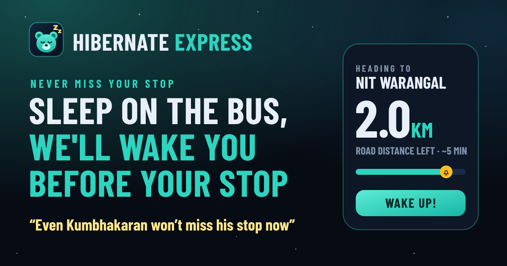
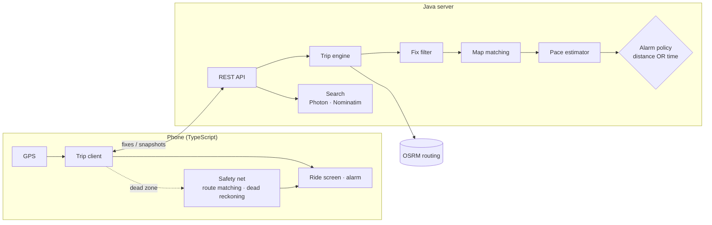

# Hibernate Express 🐻💤

**Sleep peacefully on the bus — we'll wake you before your stop.**
*“Even Kumbhakaran won’t miss his stop now.”*



Hibernate Express is a free phone web app for long bus, car and train rides. Pick your stop, choose
when you want to be woken up, and doze off. A **Java server** follows your bus along the **real road
route** and the phone rings a loud alarm (plus vibration and a notification) before you get there —
even through dead zones, and even when there's no signal at the bus stand. No sign-up, no app store.

## Features

- **One search box, like Google Maps** — place names, addresses, villages and PIN codes, with typos
  forgiven (“hyderbad”); *near me* searches such as “bus stand”, “atm near me”, “hospital near
  Kazipet” (nearest first); coordinates, plus codes (`XGMJ+F7 Warangal`) and Google Maps links,
  including the short `maps.app.goo.gl` links WhatsApp shares. Or just tap the map.
- **Alarm by distance or time** — 500 m to 10 km, or 5 to 30 minutes before arrival, whichever comes
  first. Before you start, a bell on the planned road shows exactly where it will ring. Snooze, and a
  second alarm on arrival in case you dozed off again.
- **Real road distance** — GPS fixes are map-matched onto the road route (OSRM), safely through
  U-turns and roads used twice; automatic re-routing if the driver takes another road.
- **ETA from your bus's real pace**, including signals and stops, reacting within about two minutes
  when the bus speeds up.
- **Never misses because of signal** — see [Accuracy](#accuracy) below.
- **Made for phones** — full-screen map with a draggable bottom sheet, live countdown, progress bar
  with a moving bus, a night mode that keeps the screen awake and almost black, and lots of small
  animations (pin drop, route drawing, gliding bus, ringing bell, confetti on arrival), all of which
  switch off with *reduce motion*.
- **Five alarm sounds** (including *Kumbhakaran mode*) generated as WAV in code, so they play even
  with the iPhone silent switch on; vibration on Android; notifications.
- **40-second demo ride** on a real road to hear the alarm before a real trip; resumes a trip after an
  accidental reload; recent stops; installable to the home screen.

## Accuracy

Waking you at the right moment is the whole point, so it is tested from three sides.

**1. Simulated rides through the Java engine.** `java -jar hibernate-express.jar accuracy` drives
hundreds of rides with Gaussian GPS noise along a real 143 km OSRM route (Hyderabad MGBS → Hanamkonda)
and synthetic edge cases, through the same `TripEngine` the server runs for real trips. Full report:
[docs/ACCURACY.md](docs/ACCURACY.md). Error = where it rang minus where it should (positive = early):

| Scenario | Rang | 5th–95th percentile | Worst late |
|---|---:|---:|---:|
| Highway 60 km/h, a fix every second, ±10 m GPS | 40/40 | −17 … +17 m | −33 m |
| Highway 80 km/h, a fix every 15 s, ±40 m GPS | 40/40 | −67 … +67 m | −67 m |
| City stop-and-go | 40/40 | −25 … +8 m | −25 m |
| Out-and-back road (same road twice) | 200/200 | −22 … 0 m | −44 m |
| Bus leaves the planned road (re-route) | 30/30 | −28 … 0 m | −28 m |
| GPS dead zone for 5 minutes | 30/30 | +367 … +433 m | never late |
| 10-minute alarm, steady 60 km/h | 30/30 | 0 … +11 s | −1 s |
| 10-minute alarm, bus speeds up near the end | 30/30 | −4 … +12 s | −4 s |

**2. Live trips end to end.** Seven trips at once against the real Java server, on real OSRM roads
in Hanamkonda and Warangal (4.4 km and 13 km), with simulated GPS sent in real time exactly as the
phone sends it. “Rang at” is the bus's true road distance or time left at that moment:

| Live trip | Alarm | Rang at | Result |
|---|---:|---:|---|
| Highway 60 km/h, a fix every second, ±10 m GPS | 2 km | 1,993 m | 0.4 s after the point |
| City 30 km/h with 20 s stops, a fix every 2 s | 1 km | 983 m | within one GPS fix |
| 40 km/h, a fix every 5 s (battery saving) | 500 m | 500 m | on the point |
| 80 km/h, a fix every 10 s (sparse GPS) | 2 km | 1,989 m | 0.5 s after the point |
| 60 km/h, GPS lost for 70 s just before the point | 2 km | 2,017 m | 17 m early |
| 50 km/h | 5 min | 5:00 | on time |
| City 25 km/h with 15 s stops | 5 min | 5:08 | 8 s early |

Every arrival alarm rang 120–195 m before the stop.

**3. When the server can't be reached.** The phone keeps the alarm working on its own
(`frontend/src/trip-client.ts`), and the tests in `frontend/tests/trip-client.test.ts` prove it with a
fake clock, GPS and network:

- after 3 s without an answer the phone checks the alarm rules itself;
- in a dead zone it matches GPS fixes onto the planned road and rings within a second of the right
  point — on a bent road, where a straight-line guess would be 600 m early;
- with no GPS either, it counts down 15% faster than the bus's measured pace: early, never late;
- with no signal at the start, the trip runs on the phone (straight-line distance, which can never be
  longer than the road, so never late) and moves to the server once it's reachable — without ringing
  the same alarm twice.

These are simulations and tests; real phones add effects (urban canyons, battery saving) that a model
can't fully capture.

## How it works



- **Map matching** (`trip/RouteTracker.java`): each fix is projected onto the route inside a window
  around the last position, scored by distance, by how far it strays from the progress predicted from
  ground speed, and by travel direction — so U-turns and out-and-back roads never jump to the wrong pass.
- **Pace & ETA** (`trip/PaceEstimator.java`): speed over the remaining distance in an 8-minute window
  and a 2-minute short window. The displayed ETA blends in the router's estimate until enough history
  exists; the time alarm never does — the router assumes a car, so a slow city bus would be woken at
  the start. It waits for about 20 s of measured driving and then takes the faster window (errs early).
- **Alarm policy** (`trip/AlarmPolicy.java`): distance or time, whichever first; snooze; arrival needs
  both the pin to be near *and* little road left.
- **Between fixes** (`trip/TripEngine.java`): the remaining distance keeps counting down at the measured
  pace, so sparse GPS (a fix every 5–15 s) doesn't make the alarm late.

## Project layout

```text
backend/                     Java 21+, Maven, no runtime dependencies (JDK HttpServer + HttpClient)
  src/main/java/com/hibernateexpress/
    api/                     REST API, trip sessions, rate limiting, static files
    trip/                    trip engine, map matching, pace, alarm policy, fix filter
    route/                   route geometry and polyline codec
    external/                OSRM routing; place search (Photon, Nominatim, near-me, map links)
    parse/                   coordinates and map links, plus codes
    sim/                     ride simulator and the accuracy simulation
    geo/, json/              geo maths, a tiny JSON reader/writer
  src/test/java/             JUnit 5 tests (120)
frontend/                    phone web app: TypeScript, Vite, Leaflet — no framework
  src/api.ts                 client for the Java API
  src/trip-client.ts         runs a trip against the server, with the offline safety net
  src/app.ts, src/ui/        screens, bottom sheet, map, search box, animations
  src/core/, src/services/   geometry, formatting, sounds; GPS, alarm player, wake lock
  public/sw.js               offline app shell, map tile cache, notification actions
  tests/                     Vitest (26)
docs/ACCURACY.md             the accuracy report
```

## Run it locally

You need a JDK 21+ with Maven, and Node 20.19+.

```bash
cd backend
mvn package                                        # build + 120 tests → target/hibernate-express.jar
java -jar target/hibernate-express.jar serve       # API on http://localhost:8080
```

In a second terminal:

```bash
cd frontend
npm install
npm run dev                                        # http://localhost:5180, /api goes to :8080
```

Or run everything from the Java server:

```bash
cd frontend && npm run build
cd ../backend && java -jar target/hibernate-express.jar serve --static ../frontend/dist
```

Other commands: `mvn test` (backend tests), `npm test` and `npm run typecheck` (frontend),
`java -jar target/hibernate-express.jar accuracy ../docs/ACCURACY.md` (re-generate the report),
`npm run icons` (re-render icons and the share image). Location only works on `https://` or
`localhost`.

## API

| Method | Path | What it does |
|---|---|---|
| `GET` | `/api/health` | Status |
| `GET` | `/api/search?q=&lat=&lng=&zoom=&explicit=1` | Places, near-me results, coordinates, plus codes, map links |
| `GET` | `/api/reverse?lat=&lng=` | Names a point |
| `GET` | `/api/route?from=lat,lng&to=lat,lng` | Road route (encoded polyline) |
| `POST` | `/api/coordinates` | Reads coordinates or a map link from text |
| `POST` | `/api/trips` | Starts a trip (live or demo) |
| `GET` | `/api/trips/{id}` | Trip snapshot: distance, ETA, progress, alarm state |
| `POST` | `/api/trips/{id}/fixes` | Sends a batch of GPS fixes |
| `POST` | `/api/trips/{id}/ack` · `/snooze` | “I'm awake” and snooze |
| `DELETE` | `/api/trips/{id}` | Ends a trip |

Trips live in memory (up to 5,000, removed after 3 hours idle); if the server restarts, phones start a
new trip automatically and keep the alarms they already rang. Requests are limited to 60 per 10 s per
address.

## Deploying

- **Phone app** — static files in `frontend/dist`. `frontend/netlify.toml` has the build settings and
  security headers. If the API runs on another host, build with `VITE_API_BASE=https://your-api.example`
  and add that origin to `connect-src` in the Content-Security-Policy.
- **Java server** — any host with Java 21+:
  `java -jar hibernate-express.jar serve` (environment: `PORT`, `HX_ALLOWED_ORIGIN` = the app's origin
  for CORS, `HX_STATIC` to also serve the app).

## Tips for a perfect nap

- Keep Hibernate Express open — browsers pause web pages when the phone is locked, so the app keeps the
  screen awake during a trip. Use **Night mode** to save battery, and plug in on long rides.
- Turn the media volume up. On iPhone, *Share → Add to Home Screen* to also get notifications.
- 2 km or 10 minutes is a good default for buses.

## Privacy

No account and no analytics. During a trip the Hibernate Express server receives your GPS positions to
follow you along the road; the trip is deleted when it ends (or after 3 hours idle). Through the
server, search text goes to Photon / Nominatim and a trip's start and end to OSRM; short Google Maps
links you paste are expanded by asking Google.

## Credits

Map data and tiles © [OpenStreetMap](https://www.openstreetmap.org/copyright) contributors · routing
by [OSRM](https://project-osrm.org/) · search by [Photon](https://photon.komoot.io/) and
[Nominatim](https://nominatim.org/) · maps with [Leaflet](https://leafletjs.com/) · fonts Manrope and
Barlow Condensed (SIL OFL) · icons in the style of [Lucide](https://lucide.dev/) (ISC).

## License

[MIT](LICENSE) © 2026 Sachin Chauhan
