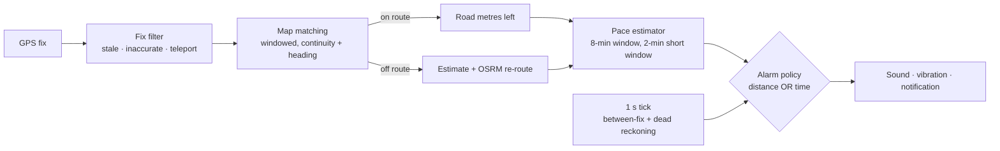

# Hibernate Express 🐻💤

**Sleep peacefully on the bus — we'll wake you before your stop.**
*“Even Kumbhakaran won’t miss his stop now.”*


Hibernate Express is a free, installable web app (PWA) for long bus, car and train rides. Pick your
stop, choose when you want to be woken up, and doze off. It follows your live GPS along the **real
road route** and rings a loud alarm (plus vibration and a notification) before you reach — no
sign-up, no app store, nothing stored on a server.

## Features

- **Pin your stop** — type-ahead place search, tap the map, or paste coordinates / a Google Maps link
  (decimal, degrees-minutes-seconds, `@lat,lng`, `!3d…!4d…`, OpenStreetMap and `geo:` links).
- **Real road distance** — the remaining distance is measured along the actual road route
  (OpenStreetMap + OSRM), not a straight line.
- **Smart alarm** — ring at a distance (500 m – 10 km) *or* a time before arrival (5 – 30 min),
  whichever comes first; snooze; a second alarm on arrival in case you dozed off again.
- **ETA from your bus's real pace** — measured over the last few minutes including signals and
  stops, reacting within ~2 minutes when the bus speeds up.
- **Re-routing** when the bus leaves the planned road, and a **GPS-loss safety net** (dead reckoning
  that leans early) for tunnels and dead zones.
- **Train mode** (straight-line distance to the station, rings slightly early).
- **Ride screen** with live map, progress bar, speed, GPS accuracy; **Night mode** (black, OLED
  friendly) that keeps the screen awake via the Screen Wake Lock API.
- **Five synthesized alarm sounds** (including *Kumbhakaran mode*), generated in code as WAV so they
  play even with the iPhone silent switch on.
- **Works offline** after the trip starts; resumes a trip after an accidental reload;
  recent stops; WhatsApp sharing; installable to the home screen.
- **40-second demo ride** that simulates a bus on a real route so you can hear the alarm before a trip.

## How the accuracy works



- **Map matching** (`src/core/route-tracker.ts`): every fix is projected onto the route inside a
  window around the last position. Candidates are scored by distance, by how far they stray from the
  progress predicted from ground speed (gentle inside the plausible range, steep beyond it) and by
  travel direction, so out-and-back roads, U-turns and loops never make progress jump to the wrong
  pass. A safety net re-anchors to the opposite pass if progress keeps sliding backwards.
- **Pace & ETA** (`src/core/pace.ts`): speed of the *remaining distance* over a sliding window,
  blended with the router's estimate until enough history exists.
- **Alarm policy** (`src/core/alarm-policy.ts`): distance or time, whichever first; snooze; arrival
  needs both the pin to be near *and* little road left.
- **Between fixes and during GPS loss** (`src/core/trip-engine.ts`): the remaining distance keeps
  counting down at the measured pace, so sparse GPS (every 5–15 s) doesn't make the alarm late, and
  a GPS dead zone errs early.

## Measured accuracy

`npm run accuracy` simulates hundreds of rides with Gaussian GPS noise on a real OSRM route
(Hyderabad MGBS → Hanamkonda, 143 km) plus synthetic edge cases, feeding fixes into the same engine
the app runs, and writes [docs/ACCURACY.md](docs/ACCURACY.md). Highlights (error = where it rang
minus where it should; positive = early):

| Scenario | Rang | 5th–95th percentile | Worst late |
|---|---:|---:|---:|
| Highway 60 km/h, fix every 1 s, ±10 m GPS | 40/40 | −17 … 0 m | −33 m |
| Highway 80 km/h, fix every 15 s, ±40 m GPS | 40/40 | −44 … +44 m | −89 m |
| Out-and-back road (same road twice) | 200/200 | −22 … 0 m | −22 m |
| Bus leaves the planned road (re-route) | 30/30 | −28 … 0 m | −28 m |
| GPS dead zone for 5 min | 30/30 | +367 … +433 m | never late |
| 10-min time alarm, steady 60 km/h | 30/30 | −1 … +7 s | −1 s |

These are simulations: real phones add effects (urban canyons, OS power saving) that a model can't
fully capture.

## Tips for a perfect nap

- Keep Hibernate Express open — browsers pause web pages when the phone is locked, so the app keeps
  the screen awake during a trip. Use **Night mode** to save battery, and plug in on long rides.
- Turn the media volume up. On iPhone, *Share → Add to Home Screen* to also get notifications.
- 2 km or 10 minutes is a good default for buses.

## Tech

TypeScript (strict) · Vite · Leaflet · OpenStreetMap tiles · OSRM routing · Photon / Nominatim
search · Service worker · Screen Wake Lock · Web Audio · Vitest. No framework, no backend.

```text
src/core/       pure, tested logic: geo maths, route line, map matching, pace, alarm policy,
                trip engine, coordinate parser, formatting, sound synthesis
src/services/   browser integrations: routing, geocoding, GPS, ride simulator, alarm player,
                wake lock, notifications, storage
src/ui/         Leaflet map view, search box, icons
src/app.ts      screens and flow
public/sw.js    offline cache + notification actions (precache list injected at build time)
tests/          unit tests + end-to-end accuracy simulation (real route fixture)
```

## Run it locally

```bash
npm install
npm run dev          # http://localhost:5180
npm test             # 73 tests
npm run accuracy     # re-generate docs/ACCURACY.md
npm run build        # type-check + production build in dist/
npm run icons        # re-render icons and the share image
```

Location only works on `https://` or `localhost`. `netlify.toml` contains the build settings and
security headers (CSP, permissions policy) for deployment.

## Privacy

No account and no analytics. Your position stays on your device; the start and end points of a trip
are sent to the public OSRM server to calculate the road route, and search text to Photon /
Nominatim.

## Credits

Map data and tiles © [OpenStreetMap](https://www.openstreetmap.org/copyright) contributors ·
routing by [OSRM](https://project-osrm.org/) · search by [Photon](https://photon.komoot.io/) and
[Nominatim](https://nominatim.org/) · maps with [Leaflet](https://leafletjs.com/) · fonts Manrope and
Barlow Condensed (SIL OFL) · icons in the style of [Lucide](https://lucide.dev/) (ISC).

## License

[MIT](LICENSE) © 2026 Sachin Chauhan
